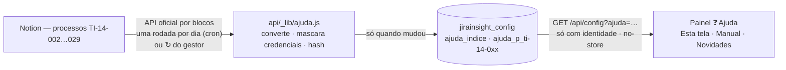

# ❓ Central de Ajuda com a documentação do Notion (2026-11-23)

Pedido do usuário: *"deixe mais fácil o acesso da ajuda, que hoje está no Notion — quem sabe um menu de ajuda onde essa
alimentação de Notion fica facilmente visível para os usuários; a intenção é facilitar o entendimento da ferramenta."*

## Decisões do usuário

| # | Decisão | Consequência |
| --- | --- | --- |
| D1 | A documentação aparece **dentro do app**, com o link "abrir no Notion ↗" ao lado | o texto dos processos TI-14 é copiado para o banco do painel e mostrado no painel ❓ |
| D2 | Botão **❓ Ajuda fixo no topo** | `#btn-ajuda-topo` no cabeçalho (tecla **F1**); o ⋯ Mais fica só com a linha "❓ Ajuda" |
| D3 | **Só para quem está identificado** (o repositório é público e o painel abre sem login) | nada do Notion vai para o GitHub nem para `public/`; a sincronização roda no servidor e a leitura exige a identidade |

## Como funciona

- **Leitura do Notion:** `GET /v1/pages/{id}` + `GET /v1/blocks/{id}/children` (paginado, recursivo até 5 níveis), `Notion-Version:
  2022-06-28` — a mesma do `scripts/roadmap-notion.mjs`. Página com `last_edited_time` igual custa uma chamada.
- **Rodada retomável:** a fila fica no índice; cada tique (ou cada volta do ↻) trabalha até o orçamento de tempo da função e devolve
  só contagens e `pendentes`. O cursor `teams_estado.ultimaSincAjuda` só avança quando a rodada completa.
- **Fase `ajuda` do cron** (`api/teams.js`): no tique noturno, logo depois da 🧭 Disciplina (o retorno do tique passou a ser
  `{disciplina, ajuda}`); no diurno, antes do teste de dia útil, só se ainda não rodou hoje. Sem `NOTION_TOKEN` registra "sem chave".
- **Manual:** `/api/teams?tipo=ajuda[&dry=1][&confirmar=1][&forcar=1][&so=ti-14-007]` com `CRON_SECRET`; o `dry=1` devolve o
  diagnóstico por página (sem texto).
- **Botão do gestor:** `POST /api/config?ajuda=1 {acao:'sincronizar', forcar?}` — gestor/admin (`planAuth` + papel), uma chamada a
  cada 30 s; o painel repete enquanto houver `pendentes`.
- **Leitura:** `GET /api/config?ajuda=indice|proc&p=ti-14-0xx|busca` — 401 sem identidade, 502 com o banco fora, `no-store` sempre;
  `'ajuda'` está em `DADOS_PARAM_PROIBIDO` do `sw.js` (sem cópia offline, de propósito — R282).

## Formato (v1, cabeçalho de `api/_lib/ajuda.js`)

- `ajuda_indice` = `{v, conv, raiz, em, okEm, fila, filaDia, procs:[{cod, arq, grupo, titulo, url, editadoEm, hash, bytes, omit,
  masc, tipos, secs:[{id,t}], sincEm, erro?}], soLink:[{cod, titulo, url}]}`.
- `ajuda_p_<arq>` = `{v, conv, cod, titulo, url, editadoEm, secs:[{id, t, n, b:[blocos]}], busca:[{s, st, x}]}` — teto de 300 KB.
- Blocos: parágrafo, títulos, listas (☐/☑ para tarefas), tabela, toggle, callout, código (mermaid = `ling:'mermaid'`), divisória;
  imagem vira `{t:'omit', tipo:'imagem'}` (sem URL — as do Notion expiram e são privadas). Inline: texto com negrito/itálico/código/
  riscado, link externo só `https`, link para outro processo (`p`) abre no próprio painel.
- **Fontes:** `AJUDA_FONTES` no código — TI-14-002 a TI-14-029 (28 páginas) + TI-14-001 só como link (é o índice + changelog, enorme).
  **Processo novo = linha em `AJUDA_FONTES`.**

## Segurança

- Só quem passa pela identidade do Jira lê (a mesma régua das outras rotas internas — inclui convidado; restringir = R280).
- **Credenciais mascaradas** na sincronização (`ajudaMascara`): tokens, JWT, webhooks, connection strings, chaves privadas viram `•••`
  e são contados no diagnóstico; a página continua publicada.
- O painel monta o conteúdo **só por `createElement`/`textContent`**; links `https` com `rel=noopener noreferrer`; o diagrama mermaid
  carrega sob demanda (versão exata + SRI, `securityLevel:'strict'`) e o SVG é limpo num `<template>` inerte antes de entrar na página.
- O gate `scripts/check-ajuda.mjs` (no `npm run check`) reprova: vista sem mapa, fonte inválida, mermaid sem versão exata ou SRI,
  `sw.js` sem `'ajuda'`, existência de `public/ajuda/` e `innerHTML` fora das linhas marcadas do painel.

## Mapa tela → seção (`AJUDA_MAPA` em `public/js/25c-ajuda-painel.js`)

Cada vista aponta para `[processo, palavra-chave do título da seção]`; a palavra é procurada no título sem acento. Sem palavra ou
sem casamento, abre o **Resumo** do processo. Conferido contra os títulos reais do Notion: 34 das 54 telas (TI-14-007, 008, 009,
010, 012, 019, 026 e 027). As outras 20 abrem o Resumo do processo certo até a conferência da 1ª sincronização real (R283).
**Tela nova = entrada em `AJUDA_MAPA`** (o gate reprova).

## O painel

- **Esta tela:** o trecho do processo da tela aberta, o "Mais deste processo" (as outras seções), 🧭 guia interativo e tours.
- **Manual:** todos os processos agrupados, com a busca (títulos primeiro, depois o texto) e o link para cada página no Notion.
- **Novidades:** a lista do app.
- **Rodapé:** 💬 Dúvidas e feedback, 🐞 Reportar, "Sincronizada com o Notion em DD/MM HH:MM · abrir no Notion ↗"; para gestor/admin,
  ↻ Atualizar a documentação agora e o Diagnóstico (erros por página, trechos mascarados, tipos de bloco ignorados).
- **Estados:** sem identidade (explica e oferece identificar-se — nenhuma chamada à API), carregando, ok, vazio (ainda não sincronizou),
  sem chave, erro e sem rede; guia, tour, novidades e o link do Notion funcionam em todos.
- **URL:** `ajp=<processo>` e `ajs=<seção>` abrem o painel no trecho (só no carregamento).

## Primeiro conteúdo — passos manuais

Este ambiente não alcança a API do Notion; o código foi testado contra um Notion falso. O texto real só aparece depois de:

1. Criar a variável **`NOTION_TOKEN`** na Vercel (pode ser a mesma integração interna do Roadmap) e fazer redeploy.
2. Dar à integração **acesso às páginas do TI-14** (página do sub-processo → ⋯ → Conexões).
3. Rodar a 1ª sincronização (❓ → ↻ Atualizar a documentação agora, ou `/api/teams?tipo=ajuda&confirmar=1` com o segredo) e
   conferir o Diagnóstico.

## Testes (scratchpad `ajuda-plano/`)

- `ajuda-conv-test.mjs` (`node --test`, 44): conversor, máscara, hash, validadores, conteúdo hostil, determinismo.
- `ajuda-servidor-test.mjs` (`node --test`, 63): sincronização retomável, cron e `?tipo=ajuda`, rotas do config, `sw.js` — handlers reais
  com Notion, Supabase e Jira falsos.
- `ajuda-tela-test.mjs` (Playwright, contra `servidor-ajuda.mjs` na porta 8799 com o conversor real): painel, abas, busca, links
  seguros, conteúdo hostil, mermaid, estados, ↻ do gestor, cache por identidade, ⋯ Mais, guias.

## Fica de fora (roadmap)

R276 perguntar à ajuda (IA) · R277 imagens · R278 ajuda por elemento e "sugerir correção" · R279 uso da ajuda · R280 por perfil e só
usuários ativos · R281 sincronização na hora e descoberta de processos · R282 offline · R283 conferência do mapa no servidor.
