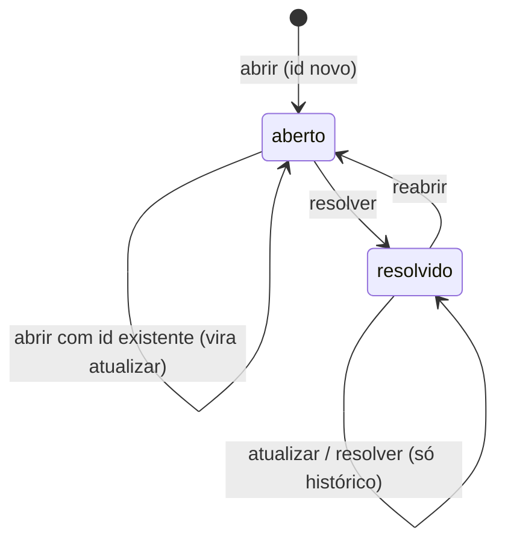

# 🚧 Pendências e bloqueios (2026-11-19, issue #230 / JI-301)

Pedido (🐞 Reportar, na tela ⏱ Apontar): os bloqueios ficavam em comentários soltos, sem resposta, sem dizer o que é
crítico e o que é só ciência; o responsável pelo entregável precisava de rastreabilidade total e de gerir o bloqueio.

## Decisões

**D1** O bloqueio mora **no ticket do Jira**: comentário com **marcador na 1ª linha** + o **flag de impedimento** nativo.
Desbloquear e atualizar também são comentários marcados. O Hub **lê do Jira** (conta de serviço); **nada em `cfg`**.
**D2** Três níveis: 🔴 Crítico (trava a entrega, atenção imediata) · 🟡 Importante (resposta com prazo) · 🔵 Ciência (só para saber).
**D3** Todo bloqueio diz **quem destrava** (pessoas do time, com @menção, ou cliente) e o **prazo**. O time é avisado por
📥 Inbox + Teams DM + Web Push; prazo vencido escala ao gerente do projeto (senão aos gestores) numa fase do cron.
**D4** O responsável pelo ticket gere: registrar, atualizar (nível, quem, prazo, nota), resolver (✅ com texto) e reabrir. O histórico é a
sequência de comentários marcados.

| # | Desenho | Constante |
|---|---|---|
| P1 | O **servidor monta e interpreta** o comentário (`api/_lib/bloqueios.js` é a fonte única); a tela só mostra uma prévia | — |
| P2 | Índice de leitura = label `bloqueio-aberto` **ou** flag preenchido; label permanente `bloqueio` guarda o histórico | `BQ_LABEL_ABERTO`, `BQ_LABEL_HIST` |
| P3 | 🔵 Ciência **não** liga o flag (não pinta o quadro de vermelho); 🔴/🟡 ligam | `BQ_FLAG_NIVEIS` |
| P4 | 🔴 Crítico avisa **também o gerente** do projeto na hora do registro | `BQ_CRITICO_AVISA_GERENTE` |
| P5 | Ticket concluído sai da lista mesmo com bloqueio aberto (limpeza automática = R245) | — |
| P6 | Qualquer pessoa identificada com permissão de comentar no Jira escreve eventos (lente, nunca permissão) | — |
| P7 | Vista `bloqueios`, aba do grupo 📥 Inbox, escopo 🙋 Meus × 👥 Todo o time | — |
| P8 | Escalonamento 1× por dia útil às 09:00; repete a cada 3 dias corridos, no máximo 3 vezes por prazo | `BQ_ESCALA_HORA`, `BQ_REESCALA_DIAS`, `BQ_ESCALA_MAX` |

## Formato v1 do comentário

Um **evento** por comentário, um parágrafo ADF por linha; cada bloqueio tem um **id** (`#` + 4–8 caracteres `[a-z0-9]`), então um
ticket pode ter vários.

```
⛔ Bloqueio · 🔴 Crítico · #b7k2
Quem destrava: @Bia Souza @Caio Reis
Prazo: 25/11/2026

Sem o acesso ao ambiente QAS não dá para testar a interface. Precisa liberar o usuário Z_INT.
```

| Evento | 1ª linha | Campos | Texto |
|---|---|---|---|
| `abrir` | `⛔ Bloqueio · <ic> <Nível> · #id` | Quem + Prazo (obrigatórios em 🔴/🟡) | obrigatório (≥ 10) |
| `atualizar` | `📝 Bloqueio atualizado · <ic> <Nível> · #id` | só o que mudou | nota (obrigatória se nada mais mudou) |
| `resolver` | `✅ Desbloqueado · #id` | — | resolução (≥ 3; "Ciente." na ciência) |
| `reabrir` | `🔁 Bloqueio reaberto · <ic> <Nível> · #id` | opcionais | motivo (≥ 3) |

Em 🔵 o rótulo é "Para ciência de:"; quem pode ser `cliente: <nome>`. Em projeto AMS o comentário sai como 🔒 nota interna por padrão.
O **parser é tolerante** (`bqParseComentario`): decide o tipo pela palavra, não pelo emoji, pula uma 1ª linha só de menções e **não**
confunde o marcador do status report (`📋 Status report · ⛔ Bloqueado…`) com um evento. Há teste de ida e volta (montar → ler).

## Máquina de estados (`bqEstado`)



Evento sem id (edição manual) vale para o único bloqueio que o aceita; evento com id desconhecido conta como órfão.

## Leitura

`GET /api/vencimentos?bloqueios=1[&resolvidos=1][&nocache=1]` (conta de serviço, cache de 3 min por instância, 502 sem cache em erro do
Jira). JQL: `labels = "bloqueio-aberto" OR cf[flag] is not EMPTY`, sem concluídos. **Por que label + flag + índice:** a label é
confiável para a busca; o flag cobre quem sinalizou direto no Jira (vira "🚩 Sinalizados sem bloqueio registrado"); o índice
`bloq_idx` (linha em `jirainsight_config`) guarda os tickets em que o projeto **não deixa gravar label**, para a lista não perdê-los.
Os comentários vêm do endpoint de comentários (a busca corta a lista). O campo do flag é `JIRA_CF_FLAGGED` ou descoberto pelo catálogo
(cache 6 h); sem ele tudo funciona só com a label e a tela avisa. Limites: 150 tickets, 300 comentários por ticket; a ficha
`?detalhe=` traz `bloqueios` sem chamada extra.

## Escrita

`POST /api/transicao {bloqueio:{acao,…}, issue, email, token}` (token da pessoa). Ordem: validar → ler `/myself` e comentários →
conferir a transição (idempotência: `abrir` com id já existente devolve `ja:true` sem comentar nem avisar de novo; `atualizar`/`resolver`
em bloqueio já resolvido volta `conflito` com o estado) → **comentário** (falhou, para) → **label** → **flag** (falha de label ou flag é dita,
não derruba a ação) → **avisos** (teto de 6 s). A resposta traz o `item` atualizado e só contagens nos avisos.

## Avisos e escalonamento

Quem recebe: o "outro lado" (se o ator destrava, avisa responsável e quem abriu; senão avisa quem destrava), sempre menos o ator; 🔴
avisa também o gerente. Teams DM e Web Push (tipo `bloqueios`, preferência por pessoa); o push leva só chave, nível, prazo e nome de
quem registrou — nunca resumo, texto, e-mail nem link no texto. **Cron** (`api/teams.js`, fase `bloqueios`, a partir das 09:00,
cursor `ultimaEscalaBloq`): lembrete 1× por bloqueio e prazo a quem destrava (cliente → responsável do ticket e quem abriu); 🔴/🟡 vencidos
escalam ao gerente do projeto (`cfg.projGerentes`, senão `cfg.gestores`), uma mensagem agregada por destinatário, repetida a cada 3 dias
até 3 vezes; estado de dedupe em `bloq_estado`. A resposta do cron traz só contagens. Manual: `?tipo=bloqueios[&dry=1][&confirmar=1]`
exige `CRON_SECRET`.

## Pontos de entrada

⏱ Apontar (selo + botão), 🛠 Gestão (botão na lista e no cartão do quadro, selo), ficha 🔍 (botão e seção 🚧 com a linha do tempo),
📋 Status report (selo + item ⋯ → ⛔ Registrar bloqueio), 🧭 Pendências (selo), 🏠 Início (card ⛔ Bloqueios), 📥 Inbox (⛔ dependem de você e
⏰ vencidos nos seus projetos), menus (👤 Meus tickets, Entrega › Tickets e alertas) e Ctrl+K (`acao:bloqueio`). O card da Início e o Inbox
somam **uma leitura** a mais na abertura (`bqGarante`, cache de 3 min).

## Ficou de fora (roadmap)

R245 limpar ao concluir o ticket · R246 📆 Hoje, 🚨 Alertas e 📅 Cronograma · R247 indicadores (tempo para destravar, por projeto) no
Dashboard e no relatório de sexta · R248 visível ao cliente no 🌐 Portal · R249 registro em lote e unificação com o "⛔ Bloqueado" do
status report · R250 prazos e escalonamento configuráveis.

## Testes (scratchpad `bloq-plano/`, fixture na porta 8797, runner `roda.sh`)

- `bloq-servidor-test.mjs` (`node --test`): **68 de 68** — lib pura, escrita, leitura, cron e manual, push e contrato.
- `bloq-smoke-test.mjs` (Playwright, contra `servidor-bloq.mjs`): **29 de 29**, sem pageerror.
- `bloq-tela-test.mjs` (Playwright, blocos A–K): **201 de 201**.
- Auditorias da vista `bloqueios`: mobile (393 e 360 px) e iPad (6 tamanhos) com 0 ofensores.
- Regressão: `sr-servidor-test` 47/47, `push-servidor-test` 14/14, `disc-servidor-test` 49/49, `push-tela-test` 93/93, `status-report-test` 28/28, `status-report-acoes-test` 179/179, `status-report-at-test` 47/47, `status-report-cab-test` 34/34, `status-report-tipos-test` 37/37, `menus-test` 185/185, `boot-test` 6/6, `erro-troca-test` 1/1.

## Passos manuais

1. Conferir nos projetos company-managed se **Labels** e **Flagged/Sinalizado** estão na tela de edição (sem Labels a tela avisa "N tickets
   sem a etiqueta"; sem Flagged o bloqueio funciona, só não sinaliza o cartão). Se o campo tiver outro nome, definir `JIRA_CF_FLAGGED`.
2. Depois do merge: `GET /api/teams?tipo=bloqueios&dry=1` com o `CRON_SECRET` e conferir a contagem; conferir `TEAMS_DM_WEBHOOK_URL` e as VAPID.
3. Teste real: registrar um 🔴 num ticket de teste e ver o comentário, o flag no quadro e a DM.
