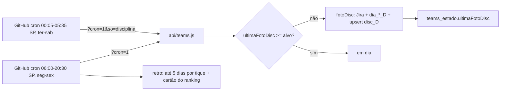

# 🧭 Disciplina do time (2026-11-16)

Pedido do usuário: indicadores enviados junto com o aviso diário do Teams — ticket que fica vencido de um dia para o
outro e se a pessoa usou o 📆 Hoje para planejar o dia —, uma **foto à meia-noite** desses indicadores e a **evolução
no tempo**.

Decisões: **D1** vai no cartão geral do ranking, com totais e nomes, sem R$ · **D2** três indicadores (vencidos que viram
o dia, planejou o dia, fechou o dia) · **D3** aba nova "🧭 Disciplina do time" no 📈 Dashboard de KPIs (dia a dia e semana a
semana, por pessoa) e ▲▼ no cartão contra o dia anterior e a média de 7 dias úteis · **D4** foto à meia-noite de SP, só de
dia útil, do dia útil que acabou.

## Indicadores (dia D = dia útil fotografado)

| Indicador | Regra |
|---|---|
| Vencidos que viraram o dia | `duedate <= D` e aberto à meia-noite de D, **todos os tipos**, sem filtro de ARQ — a mesma régua do card "⚠ Meus tickets vencidos" da Início. `novos` = vencimento depois do dia útil anterior; `vmax` = idade do mais antigo. Responsável fora do público (sem responsável, ausente, oculto, meta 0) vai em `fora` e não entra no total. |
| Planejou o dia | carimbo `plan1` (do servidor; antes dele, `planejadoEm` do cliente) em dia `<= D` **e** pelo menos 1 item sem `movido`. Planejar depois do meio-dia conta; `cedo` separa quem planejou na véspera ou até 12:00. |
| Fechou o dia (🌙) | carimbo `fech1` (do servidor; antes, `fechadoEm`) em dia `<= D`. Fechar e mexer depois continua contando; fechar na manhã seguinte não. |

Público = `discPublico` (a mesma regra do ranking: ativos do Jira − ocultos − ausentes em D − meta 0).

## Foto `disc_<AAAA-MM-DD>` (formato v1 no cabeçalho de `api/_lib/disciplina.js`)

Linha própria em `jirainsight_config` (nunca na `cfg`). Tem `time`, `fora` e `porPessoa` — só contagens, sem e-mail, sem
chave ou título de ticket. Retenção de 400 linhas. Upsert idempotente que **nunca rebaixa** o modo:
`noite` (tique entre 00:00 e 05:59 de D+1) > `recuperada` (até o fim do próximo dia útil; guarda a hora real) > `retro`
(mais tarde: vencidos viram `null`, porque `duedate` e responsável mudam e o passado não se reconstrói; planejou/fechou
vêm dos carimbos).

## Agendamento

A fase roda **antes** do ranking, para o cartão das 08:00 achar a foto. O tique noturno não depende do webhook do
Teams. Manual: `?tipo=disciplina[&dia=][&dry=1][&confirmar=1][&forcar=1]`, com `CRON_SECRET`. A resposta do cron traz só
contagens.

## Cartão do Teams

`blocosDisciplina` (api/teams.js) lê a foto do mesmo dia do ranking e as até 7 anteriores: três tiles, a lista de
quem tem vencido, quem não planejou e quem planejou e não fechou (até 12 nomes por lista), ▲▼ e a média só com 3 ou mais
fotos. Sem foto: uma linha de aviso. Falha de leitura nunca derruba o ranking.

## Tela

`GET /api/config?disc=1&gran=dia|sem&n=&ate=` (`discRota`; 401 sem identidade, 502 com a config ilegível, `no-store`,
recorte por papel no servidor). Módulo `public/js/18d-disciplina.js` (aba `dashdisc`), reusando as primitivas do `18c`.
Fica fora de propósito (roadmap): mês a mês e prévia do dia corrente (R209), lembrete individual (R210), metas e alerta
(R211), chaves dos vencidos (R212), relatório de sexta (R213).
